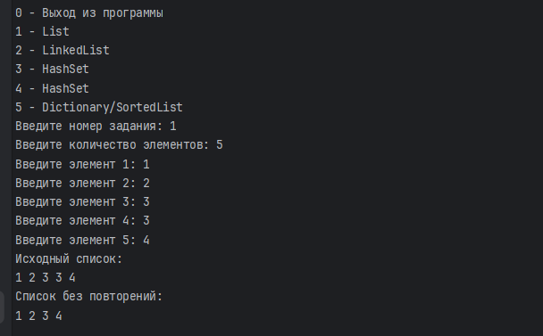
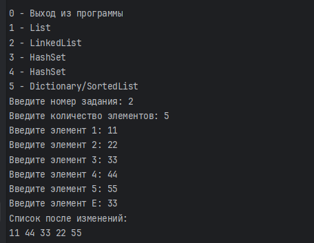
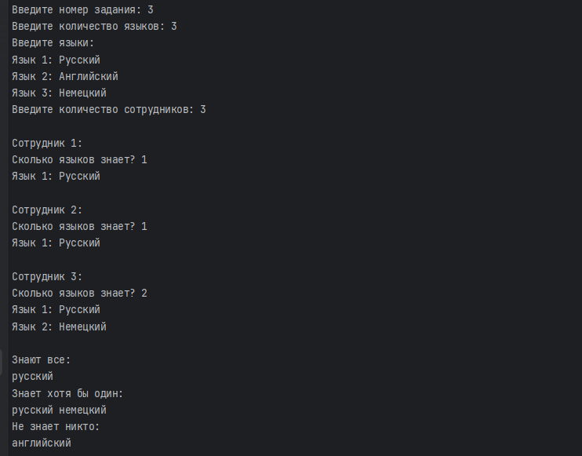
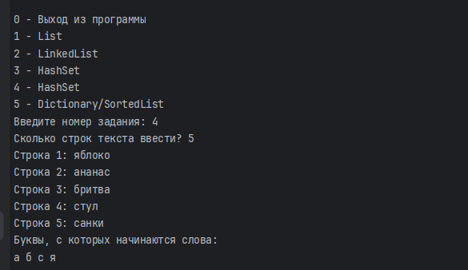
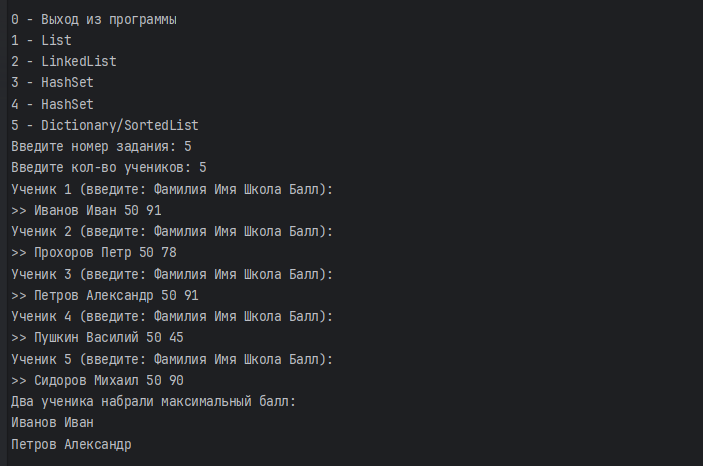
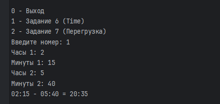
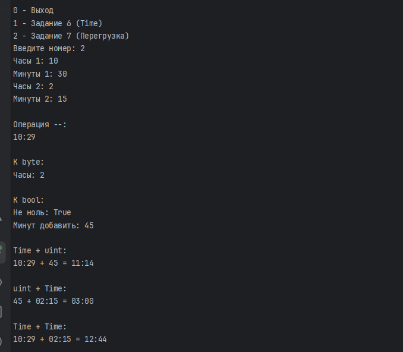
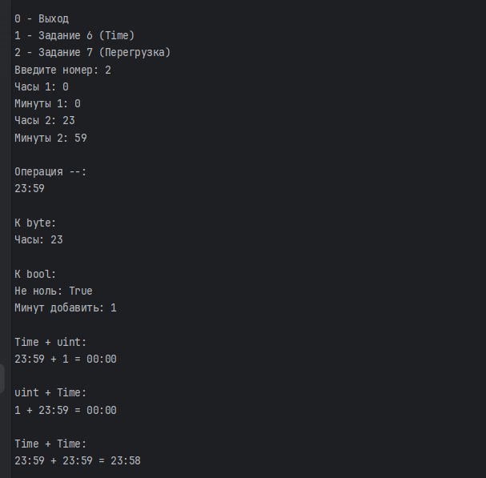

# Лабораторная работа №4

## Задача 1. Удаление повторяющихся элементов из списка

- **Текст задачи:** Создать список целых чисел, заполнить его элементами, введёнными пользователем, и сформировать новый список, содержащий только уникальные элементы исходного списка. При этом порядок первого появления элементов должен сохраняться.

- **Алгоритм решения:** Для хранения исходных чисел используется коллекция `List<int>`, а для результата — отдельный список `List<int>`. Пользователь вводит количество элементов и сами значения. После заполнения исходный список выводится на экран. Затем программа последовательно перебирает его элементы и использует коллекцию `HashSet<int>` для проверки наличия повторений. Метод `Add()` возвращает `true`, если элемент ещё не содержался в множестве. В этом случае элемент добавляется в результирующий список. Таким образом, сохраняются только первые вхождения чисел и исходный порядок их появления. В конце программа выводит список без повторений.

- **Тестирование:** Проверить работу программы на списке с повторяющимися числами. Например, ввести `1, 2, 3, 3, 4`. Убедиться, что исходный список содержит все введённые элементы, а результирующий — только `1, 2, 3, 4`.

## Задача 2. Обмен значений соседних элементов связанного списка

- **Текст задачи:** Создать двусвязный список целых чисел. Пользователь вводит значение элемента E. Для каждого элемента списка, равного E, необходимо поменять местами значения предыдущего и следующего элементов, если оба соседних элемента существуют и их значения различаются.

- **Алгоритм решения:** Для хранения чисел используется коллекция `LinkedList<int>`. После ввода количества элементов и их значений программа запрашивает значение E. Перебор выполняется с помощью ссылок на узлы `LinkedListNode<int>`, начиная с первого узла списка. Если значение текущего узла совпадает с E, программа проверяет наличие предыдущего и следующего узлов с помощью свойств `Previous` и `Next`. Если оба узла существуют, а их значения различаются, значения временно сохраняются в переменной и меняются местами. После обработки текущего узла программа переходит к следующему. В конце выводится изменённый список.

- **Тестирование:** Ввести список `11, 22, 33, 44, 55` и значение E = `33`. Проверить, что элементы перед и после найденного узла поменялись местами: результат должен быть `11, 44, 33, 22, 55`.

## Задача 3. Определение знаний сотрудников с помощью HashSet

- **Текст задачи:** Составить список языков программирования и определить, какими языками владеют все сотрудники, хотя бы один сотрудник и ни один сотрудник.

- **Алгоритм решения:** Для хранения общего перечня языков и наборов языков каждого сотрудника используются коллекции `HashSet<string>`. Сначала пользователь вводит количество языков и их названия. Повторное добавление одного и того же языка не допускается. Затем вводится количество сотрудников и информация о языках, которыми владеет каждый из них. При вводе проверяется, что язык присутствует в общем перечне и не был добавлен этому сотруднику ранее.

  После получения данных программа выполняет операции над множествами:
  - `IntersectWith()` — находит пересечение наборов языков и определяет языки, известные всем сотрудникам.
  - `UnionWith()` — объединяет наборы и определяет языки, известные хотя бы одному сотруднику.
  - `ExceptWith()` — исключает известные хотя бы одному сотруднику языки из общего перечня, оставляя языки, которыми не владеет никто.

  Полученные результаты выводятся на экран.

- **Тестирование:** Ввести три языка: русский, английский и немецкий. Для первого сотрудника указать русский, для второго тоже, а для третьего русский и немецкий. Проверить, что результат содержит русский в разделе «Знают все», русский и немецкий в разделе «Знает хотя бы один», а в разделе «Не знает никто» английский язык.

## Задача 4. Поиск первых букв слов в текстовом файле

- **Текст задачи:** Создать текстовый файл, содержащий несколько строк. Определить все различные буквы, с которых начинаются слова в этом файле, и вывести их в отсортированном порядке.

- **Алгоритм решения:** Сначала пользователь задаёт количество строк и вводит текст. Строки записываются в файл `task4_text.txt` с помощью `StreamWriter`. Затем программа открывает файл для чтения с помощью `StreamReader` и последовательно обрабатывает каждую строку. Для определения начала слова проверяется текущий символ: он должен быть буквой, а предыдущий символ либо отсутствовать, либо не являться буквой. Найденные буквы переводятся в нижний регистр и добавляются в `HashSet<char>`, что исключает повторения. После обработки файла элементы множества переносятся в список `List<char>`, сортируются методом `Sort()` и выводятся на экран.

- **Тестирование:** Ввести несколько строк, например: `яблоко, ананас, бритва, стул, санки`. Проверить, что программа определяет первые буквы слов, исключает повторения и выводит результат в отсортированном порядке.

## Задача 5. Определение лучших учеников школы № 50

- **Текст задачи:** Используя структуру для хранения информации об учениках, сохранить данные в текстовый файл, выбрать учеников школы № 50 и определить лучших по количеству набранных баллов.

- **Алгоритм решения:** Для хранения данных об ученике используется структура `Student`, содержащая фамилию, имя, номер школы и набранный балл. Пользователь вводит количество учеников и информацию о каждом из них. Введённые данные записываются в файл `task5_text.txt`.

  После записи программа считывает файл и выбирает только учеников школы № 50. Для выбранных учеников определяется максимальный балл. Далее программа рассматривает несколько случаев:
  - Если максимальный балл набрали более двух учеников, выводится соответствующее сообщение и количество таких учеников.
  - Если максимальный балл набрали два ученика, выводятся их фамилии и имена.
  - Если максимальный балл набрал один ученик, программа ищет следующий по величине балл. Если его набрал только один человек, выводятся лучший и второй по успеваемости ученики. Если следующий балл набрали несколько человек, выводится информация о неоднозначности второго места и данные лучшего ученика.

  Если в школе № 50 нет учеников, программа сообщает об этом.

- **Тестирование:** Ввести не менее пяти учеников. Проверить, что при обработке учитываются только ученики школы № 50. Проверить, чтобы в примере с двумя учениками, набравшими одинаковое максимальное количество баллов вывод работал корректно.

## Задача 6. Перегрузка операции вычитания для класса Time

- **Текст задачи:** Создать класс `Time` для представления времени в часах и минутах. Реализовать перегрузку бинарной операции вычитания двух объектов класса `Time`. Результат операции должен быть представлен объектом того же класса с учётом перехода через начало суток.

- **Алгоритм решения:** В классе `Time` используются два закрытых поля типа `byte`: `_hours` и `_minutes`. Конструктор принимает часы и минуты и проверяет их допустимые значения: часы должны находиться в диапазоне от 0 до 23, минуты — от 0 до 59. Для удобного доступа к значениям предусмотрены свойства `Hours` и `Minutes`.

  Для упрощения вычислений используется свойство `TotalMinutes`, которое переводит время в общее количество минут с начала суток. Метод `Subtract()` вычисляет разность общего количества минут двух объектов. Чтобы результат оставался неотрицательным и учитывался переход через начало суток, к разности прибавляется 1440, после чего применяется операция остатка от деления на 1440.

  Полученное количество минут преобразуется обратно в часы и минуты. Для использования операции вычитания между объектами перегружен оператор `-`, который вызывает метод `Subtract()`. Метод `ToString()` обеспечивает вывод времени в формате `чч:мм`.

- **Тестирование:** Проверить обычное вычитание: `02:15 - 05:40 = 20:35`. Убедиться, что результат корректно отображается в формате `чч:мм`.

## Задача 7. Перегрузка операций и преобразований типов для класса Time

- **Текст задачи:** Дополнить класс `Time` перегрузкой унарной операции `--`, явным преобразованием к типу `byte`, неявным преобразованием к типу `bool`, а также перегрузкой бинарной операции сложения для пар `Time` и `uint` в обоих порядках операндов и для двух объектов `Time`.

- **Алгоритм решения:** Для класса `Time` реализованы следующие операции и преобразования:

  - **Унарный оператор `--`:** уменьшает время на одну минуту. Для этого от общего количества минут отнимается единица. Если время равно `00:00`, после операции получается `23:59`.
  - **Явное преобразование к `byte`:** возвращает значение часов объекта `Time`, не учитывая минуты. Для этого используется оператор `explicit`.
  - **Неявное преобразование к `bool`:** возвращает `true`, если часы или минуты не равны нулю. Для реализации используется оператор `implicit`.
  - **Оператор `Time + uint`:** прибавляет к объекту времени заданное количество минут. Для вычислений используется метод `AddMinutes()`.
  - **Оператор `uint + Time`:** выполняет аналогичное сложение при обратном расположении операндов.
  - **Оператор `Time + Time`:** складывает общее количество минут двух объектов, после чего преобразует результат обратно в часы и минуты с учётом перехода через сутки.

  Для операций сложения используется циклический переход через 24 часа, поэтому итоговое время всегда находится в диапазоне от `00:00` до `23:59`.

- **Тестирование:** Проверить все реализованные операции на двух примерах:
  - **Пример 1:** Первое время — `10:30`, второе — `02:15`, количество минут для сложения — `45`. Проверить уменьшение времени оператором `--` (`10:29`), явное преобразование к `byte` (`2`), неявное преобразование к `bool` (`True`), сложение `Time + uint` (`11:14`), `uint + Time` (`03:00`) и `Time + Time` (`12:44`).
  - **Пример 2:** Первое время — `00:00`, второе — `23:59`, количество минут для сложения — `1`. Проверить уменьшение времени оператором `--` (`23:59`), преобразование к `byte` (`23`), преобразование к `bool` (`True`), сложение `Time + uint` (`00:01`), `uint + Time` (`00:00`) и `Time + Time` (`23:59`).

Дополнительная проверка нулевого времени и перехода через начало суток:

## Вывод

В ходе лабораторной работы были изучены и применены основные коллекции .NET: `List`, `LinkedList` и `HashSet`. Были закреплены навыки работы со связанными списками, множествами, текстовыми файлами и структурами.

Также был реализован пользовательский класс `Time`, для которого выполнена перегрузка арифметических операций и преобразований типов. В результате работы получены практические навыки работы с коллекциями, файлами, структурами, классами и перегрузкой операторов в C#.
